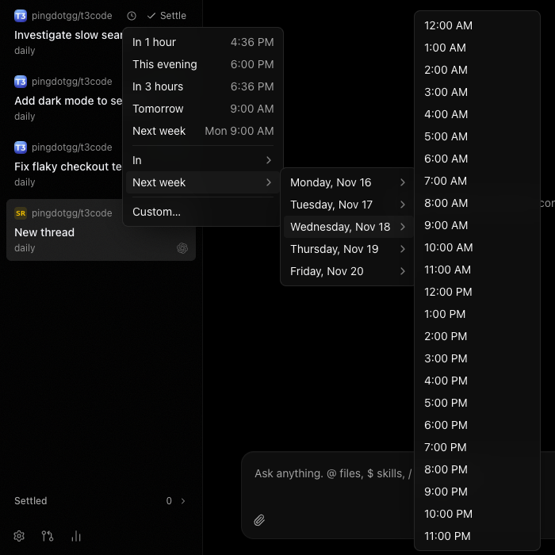

# T3 Code daily

Upstream [T3 Code](https://github.com/pingdotgg/t3code) nightlies with a few local patches.

## What's different from upstream

The patches live on the `daily` branch. List them with
`git log --oneline upstream/main..daily`.

### Drill-down snooze menu

The snooze menu on a sidebar row, and **Snooze** in a thread's menu, gain two submenus below
your presets:

- **In → Hours → 1 to 24 hours**, or **In → Days → 1 to 14 days**
- **Next week → Monday to Friday → any hour**, for example *Next week → Wednesday, Nov 18 → 2:00 PM*

A next-week choice remembers the exact time the menu showed, so picking it just after midnight
still snoozes to the day you saw. **Custom…** stays at the bottom.



### Import cookies from a browser tab's menu (desktop)

Upstream imports cookies only when you create a new browser profile, and you must quit the
source browser first. Here, any browser tab can import into the profile it already uses:

**⋯ → Import cookies from → Chrome · Default**: the cookies are copied into the tab's profile
and the page reloads, already signed in.

- Chrome-based browsers and Safari can stay open on macOS and Linux. The import reads a copy of
  their cookie database, not the live file. Firefox, Zen and every browser on Windows still have to
  be closed.
- It also works for tabs the server runs. The desktop app decrypts the source browser's cookies,
  then the server loads them into that tab's browser through a new `preview.importCookies` call.
- The **Add profile** flow in **Settings → Browser** uses the same no-quit import.

### T3 Connect works when `--host` names a specific address

Binding the server to one address, such as a Tailscale IP:

```sh
t3 serve --host 100.64.0.10
```

made the server register that address as its origin with the T3 Connect relay. The relay accepts
only loopback origins, so it answered 401, which the server misread as "link revoked" (starting with upstream
0.1.10-nightly.20261112). This build registers `127.0.0.1` (or `[::1]`) instead; put a
loopback forwarder in front of the server if nothing listens there. A host already marked
revoked recovers on its own once it starts this build; don't re-link it.

### macOS builds without an Apple team

When `T3CODE_APPLE_TEAM_ID` is unset, `scripts/build-desktop-artifact.ts` signs the app with
whichever certificate electron-builder finds, and uses the runtime entitlements without the
passkey ones (those need an Apple team and a provisioning profile). That is how this repository
signs its releases with a self-signed certificate. As a result, passkey sign-in in the built-in
browser is not available in this build.

## How releases are built

- `daily`: the patches, on top of an upstream nightly tag.
- `fork-ci` (default branch): `.github/workflows/daily-release.yml`. Every 4 hours it takes the
  newest upstream nightly tag, cherry-picks `daily` onto it, builds the macOS arm64 app, the
  Linux x64 app (AppImage and .deb) and the Linux x64 `t3` archive, and publishes them here as a
  release with the same version. If the
  patches stop applying, the run fails and nothing is published.

The macOS app is signed with a self-signed certificate (secrets `CSC_LINK`, `CSC_KEY_PASSWORD`). The in-app
updater only installs builds signed by the same certificate, so do not replace it.

## Machines

**macOS desktop:** quit T3 Code, install the `.dmg` from the newest release over
`/Applications/T3 Code (Nightly).app`, then run
`xattr -dr com.apple.quarantine "/Applications/T3 Code (Nightly).app"` (the app is not notarized).
After that, Settings → About updates from this repository.

**Linux desktop (x64):** quit T3 Code and install the newest release's `.deb`
(`sudo apt install ./T3-Code-*-amd64.deb`) or AppImage in place of the official one. Linux builds
are unsigned, upstream's included, so nothing else changes; the in-app updater then follows this
repository.

**`t3` hosts (Linux x64):** point the service and your shell at this repository's archives:

```sh
mkdir -p ~/.config/systemd/user/t3code.service.d
printf '[Service]\nEnvironment=T3CODE_RELEASE_BASE_URL=https://github.com/dbachelder/t3code/releases/download\n' \
  > ~/.config/systemd/user/t3code.service.d/daily.conf
systemctl --user daemon-reload
echo 'export T3CODE_RELEASE_BASE_URL=https://github.com/dbachelder/t3code/releases/download' >> ~/.profile
T3CODE_RELEASE_BASE_URL=https://github.com/dbachelder/t3code/releases/download \
  t3 update <newest release version, e.g. 0.1.8-nightly.20261107.4340> --yes
```

`t3 update` without a version picks the newest upstream nightly, which fails until this
repository has published it.

## Changing the patches

```sh
git fetch upstream --tags
git switch daily && git rebase --onto <new nightly tag> <old base tag> daily
git push --force-with-lease fork daily
gh workflow run daily-release.yml -R dbachelder/t3code
```
